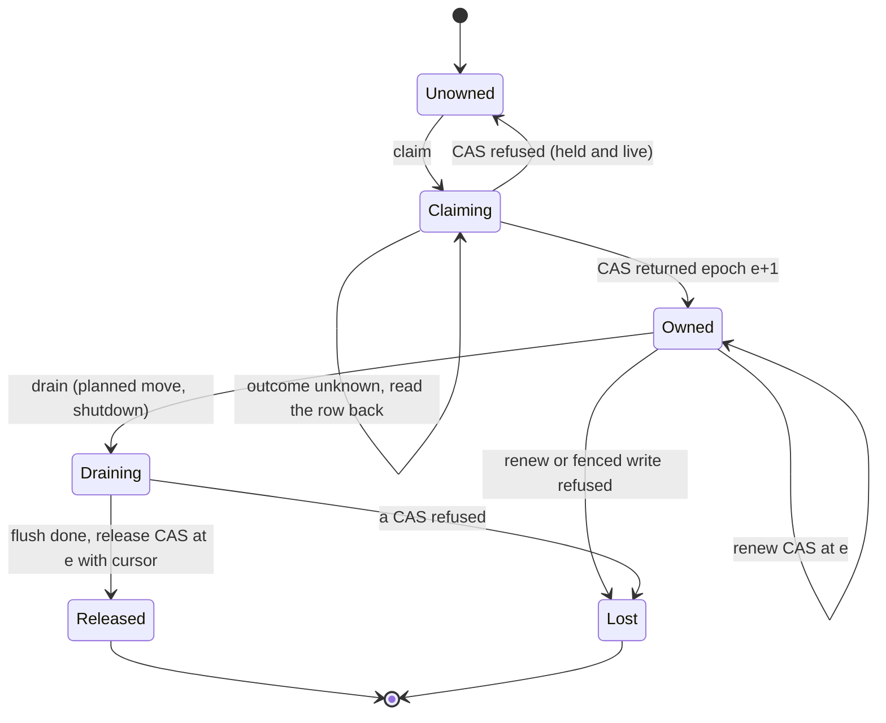

# Concurrency

Nanocode has to stay correct under heavy load by design, not because callers are careful. Every piece of shared state belongs to exactly one owner. Ownership is a lease with an epoch. Every durable write is a compare-and-set against that epoch or a revision. Nothing waits on a lock: a contended write either lands or is refused, and the refusal has a type.

This file holds the rules, the ownership model, and the map of everything that still breaks a rule, with its replacement. An entry leaves the map when the commit that removes it lands.

## Rules

1. **One writer per scope per epoch.** A scope is a thread's log, a board, a log partition, a durable state or a workspace head. At most one owner holds a scope at a given epoch, and only that owner's writes at that epoch can land.
2. **No lost acknowledged writes.** An append that returned `Ok` is durable and stays visible to every later owner. A handoff carries the committed position forward. It never re-derives it.
3. **No lock across `.await` or the network.** In process there is no `Mutex`, `RwLock`, `Condvar`, `Owned`/`Held`/`Leased` guard, `Semaphore::new(1)` or `Sequencer` turn held across a suspension point. In the database there are no advisory locks (session or transaction), no `FOR UPDATE`/`FOR SHARE`/`FOR KEY SHARE`, and no no-op `UPDATE` used as a mutex. The only row locks are the ones Postgres takes for the single compare-and-set statement itself, inside a pipelined transaction that never waits on the client.
4. **No DDL on open.** Schema changes run in a one-shot `migrate` step before anything serves. Opening a store reads the stored format version once per process and returns `SchemaBehind` if it's old. It never creates, alters or indexes anything.
5. **Liveness is lease expiry, judged on the database clock.** A dropped connection, proxy cut or failover is a transport event. It doesn't mean ownership is lost. Ownership is lost only when a fenced write or a renewal compare-and-set says the epoch moved.
6. **Every wait has a deadline.** Pool checkout, `lock_timeout`, `statement_timeout` and `idle_in_transaction_session_timeout` are set for every transaction class. When a deadline passes, the caller gets a typed refusal (`Busy`, `Lost`, `SchemaBehind`), never a hang.
7. **Capacity is not ownership.** A `Semaphore` bounds resources (CPU, memory, connections), and its permit is acquired with a deadline. It never serializes access to state.

## Ownership: the lease state machine

Each scope has a lease. In process, its state is one enum, and each variant carries only what that phase has:

```text
Unowned
Claiming { attempt }                     claim CAS in flight; its outcome may be unknown
Owned    { epoch, expires_at, cursor }   the only state that may write
Draining { epoch, expires_at, cursor }   admits nothing new; flushes the group commit
Released { epoch, cursor }               handed back at a known cursor; claimable at once
Lost     { epoch, by }                   a CAS said the epoch moved; terminal for this epoch
```



Transitions are typed functions from one variant to another, driven only by compare-and-set answers and the clock. The answer to an ambiguous claim (timed out, outcome unknown) is read back from the row before anything is decided. It is never assumed.

The lease row (it generalizes `nanocode_log_fence` and `nanocode_partitions::Row`):

```sql
scope      TEXT PRIMARY KEY
epoch      BIGINT NOT NULL      -- rises on every claim, never reused
holder     TEXT                 -- node id and address; NULL when Released
expires_at BIGINT NOT NULL      -- database clock, ms
cursor     BIGINT NOT NULL      -- last committed position, set on release
```

- **Claim** (`Unowned → Claiming → Owned`): `UPDATE … SET epoch = epoch + 1, holder = $me, expires_at = now + ttl WHERE scope = $1 AND (holder IS NULL OR holder = $me OR expires_at + grace < now) RETURNING epoch, cursor`. `grace` is at least the longest transaction any owner can run (`statement_timeout`). So a stale owner's last in-flight write has committed or failed before anyone claims an expired lease.
- **Renew** (`Owned → Owned`): `UPDATE … SET expires_at = now + ttl WHERE scope = $1 AND epoch = $e AND holder = $me`. Zero rows means `Lost`. Renewals are batched per node, one statement for all of its scopes. A renewal touches only the lease row, so it never waits behind a commit.
- **Fenced write**: every write transaction is one pipelined batch, and its first statement is a compare-and-set on the scope's head. Examples are `UPDATE head SET pos = pos + $n WHERE scope = $1 AND epoch = $e RETURNING pos`, or the log's own `PRIMARY KEY (scope, seq)` collision. Zero rows means `Lost`. With one owner per scope there is never a second writer queued on the head. A claim waits for at most the one commit in flight.
- **Drain and release** (`Owned → Draining → Released`): stop admitting work, flush the group commit, then `UPDATE … SET holder = NULL, cursor = $c WHERE scope = $1 AND epoch = $e`. The gainer claims a `Released` row at once: no TTL wait, and no full re-read, because it resumes from the snapshot at or before `cursor`.
- **Owner self-fence**: an owner stops issuing writes when its local deadline (`expires_at - margin`) passes without a renewal landing. It doesn't wait to be told.

### Scaling out: one owner per scope, routed like a Durable Object

- A scope hashes to a partition, and a partition has one owner node. That owner runs one task (a `Mailbox`/`Actor`) per live scope. All of the scope's state lives in that task by value, and its reads come from an `Atom<Arc<Snapshot>>` that it publishes after each commit.
- A request on any replica goes to the scope's owner: in-process if the owner is local, or forwarded to the `holder` address from the lease row if it isn't. A replica with no owner for the scope claims it. Replicas share no locks and need no coordination code. Adding owners adds throughput, because partitions don't contend.
- A handoff is an epoch bump. The old owner drains and releases, the new one claims at `epoch + 1`, and any write the old owner still sends is refused as `Lost`.

### Schema

- `migrate(sql) -> Migrated` is the only function that runs DDL. It sets `lock_timeout`, builds indexes `CONCURRENTLY` (outside a transaction), and records each component's format in `nanocode_formats`. It runs as a one-shot step at deploy time, never from `open`, `prepare`, `claim` or a request.
- Every store constructor takes `&Migrated`, so code that hasn't migrated can't open a store. `Migrated` is built either by `migrate` or by `Migrated::check(sql)`, which is one `SELECT` of `nanocode_formats`. `check` returns `SchemaBehind` when a format is old, and its result is cached for the whole process.
- A data conversion (a table copy or type change) is an expand step, then a batched background backfill owned by a lease, then a contract step. It never runs inside a request.

### Checking it

- `bin/nanocode-sim` models the lease row, owners, the network and the database clock. It drives every transition, injects a crash after every step (before and after each CAS lands, between flush and release), and plays stale-epoch writes after every handoff.
- Each rule has an invariant check and a mutation that breaks it: claim keeps the epoch (rule 1), release drops the cursor (rule 2), renew ignores the epoch, the claim skips `grace`, and the write skips the head CAS (rule 1). The sweep must turn red for each mutation.
- Under load, the measurement is: no lock waits (sampled `wait_event_type = 'Lock'` and `pg_locks WHERE NOT granted`), no statement timeouts, throughput that grows with the number of owners, and handoff stall time.

## The map: what still breaks a rule

Locations are paths at master. "Rule" is the rule broken. "Replacement" is what removes the entry.

### Database locks and fences

| Entry | Location | Why it exists | Failure under load | Rule | Replacement |
|---|---|---|---|---|---|
| Parted fence row lock | `crates/core/turnlog/src/parted/sql.rs` `LOCK`, used by `fenced()` | A claim's fence swap can't commit between a commit's epoch check and its insert, and positions follow commit order | Every commit, compaction and prune of a partition queues on one row for the whole transaction, including the WAL flush. Claim and renew swaps wait behind commits, so leases lapse under write load | 3 | One owner per partition does group commit, so there's one committer. The head CAS (`pos`/epoch) is the first statement. Renewals move to the lease row. Drop `LOCK` |
| Parted lease on the node clock | `parted/mod.rs` `claim`/`renew`/`release`, `crates/core/partitions` `Row` | Partition ownership by full-row CAS | `expires_ms` comes from each node's own clock, so clock skew shortens or stretches leases. No `Draining`/`Released` visible to peers | 5 | The lease row above on database time, with `Draining` and `Released { cursor }` |
| Parted prepare re-creates partitions | `parted/sql.rs` `PARTS` through `migrate_format_then` | Creates `LIST` partitions and fence rows | Runs `CREATE TABLE IF NOT EXISTS … PARTITION OF` (`AccessExclusive` on the parent) on every prepare, even when the format is current | 4 | Partition count is part of the format and is created only by `migrate` |
| Retention pinned by dead cursors | `parted/sql.rs` `DROP`/`PRUNE`/`INSERT_COMPACTING` `min(pos)` over `nanocode_log_cursor` | Never delete rows that a reader hasn't consumed | One dead reader stops retention for its partition, so the table and scans grow without bound | 5 | Cursors are leases with an expiry, and retention ignores expired cursors |
| `NOTIFY` on commit | `parted/sql.rs` `INSERT`/`INSERT_COMPACTING` (`$4 = 1`), `NOTIFY_PG` | Wakes followers on other nodes | Every notifying commit takes Postgres's cluster-wide notify lock. A listener that stops reading fills the queue | 3 | Followers read each partition's committed `pos`. At most one coalesced notify per partition per interval, outside the commit |
| Owner `FOR SHARE` | `crates/core/durability/src/sql.rs` `INSERT_RECORDS`, `HOLD`, `GROUP_HOLDS_PG`, `GROUP_REPLACE_PG`, `REPLACE` | An acquire's fence bump can't land between a write's fence check and the write | Many writers share-lock the same owner row, which creates MultiXacts, SLRU contention and early anti-wraparound vacuums. Acquire waits for every sharer | 3 | Fence and revision on the state row itself, with one CAS `UPDATE … WHERE revision = $r AND fence = $f` (what `RowStore` does) |
| Records `FOR KEY SHARE` | `durability/src/sql.rs` `GROUP_LOCK_RECORDS_PG` | `collect` can't delete a record a commit is about to reference | Hot records get MultiXacts. `collect`'s `FOR UPDATE` waits on all of them, and new commits wait behind `collect` | 3 | Records are immutable. GC is mark-and-sweep with a grace period, so references are inserted without locks |
| `collect` row-lock mutex | `durability/src/sql.rs` `HOLD_OWNER`, `LOCK_RECORDS`, `FENCE` | Serializes GC against writers and acquire | It takes owner then records, while group commit takes records then owner: a deadlock. It also bumps a live owner's fence | 3 | Only the scope's owner collects its own state, at its epoch. GC never fences another owner |
| Acquire always steals | `durability/src/sql.rs` `ACQUIRE`, `durability/src/row.rs` `acquire`, `durability/src/kv.rs` CAS loop, `crates/core/workspace-fs/src/sql.rs` `CLAIM_ANY` | The newest acquirer wins and fences the previous owner | Two runtimes that both think they own a state fence each other in turn (livelock). Every steal forces a full reload | 1 | The claim CAS above: steal only when `Released` or expired past `grace` |
| Compaction fences the owner | `durability/src/row.rs` `COLLECTED` (`fence = fence + 1`) | Owner writes can't target the layout from before compaction | A sweep during traffic fences the hottest states, causing a wave of `Fenced` errors and reloads | 1 | Compaction is an owner operation at its epoch |
| Shared blob refcount row | `workspace-fs/src/sql.rs` `refs` update on put/release | Content-addressed blobs are shared across workspaces | One popular blob row is updated by every workspace | 3 | A `(workspace, digest)` reference row per workspace, with mark-and-sweep |
| Session log guard by division error | `crates/runtime/agent/src/session_log.rs` `CHECK_TAIL` (`1 / count(*)`), `APPEND_TAIL` | Two writers of one session log can't interleave | Contention shows up as aborted transactions, then a stale reload (three queries), then a retry | 1 | The session log is a scope with a lease. Appends CAS on epoch, and zero rows means `Lost` |
| `nc-board` actor hold | `bin/nc-board/src/cli.rs` `HOLD`/`UNHOLD` (`pg_advisory_lock`), `advise`, `locked` | One actor's writes from parallel CLI calls don't race | Blocks with no timeout while pinning the pool's single connection. A killed CLI behind a pooling proxy keeps the lock | 3 | Keyed writes (`Board::submit_keyed`) and the log's seq CAS. Being removed |
| `nc-board` file lock | `bin/nc-board/src/cli.rs` `open(dir)` `board.lock` | Same as above, for the directory store | A blocking `flock` with no timeout | 6 | The `FileLog` seq check |
| Session lock framework | `crates/core/sync/src/session.rs` `SessionLocks`, `SessionLock`, `Locker` | Hands out connection-bound locks with a keepalive | Each held lock pins a connection, so N holders exhaust the pool. The lock vanishes on failover (see "Handoff" below) | 3, 5 | Delete it. Nothing in the workspace uses it. Being removed |
| No timeouts | `crates/integrations/store-sql/src/postgres/{pool,sql,connection}.rs` | — | Pool `acquire` waits forever. No `lock_timeout`, `statement_timeout` or `idle_in_transaction_session_timeout` is set, so one blocked statement holds its connection until the server gives up | 6 | Set all three per transaction class, give acquire a deadline, and cancel the server statement on client timeout |
| SQLite `BEGIN IMMEDIATE` for reads | `bin/nc-lite/src/sqlite.rs` | Avoids `SQLITE_BUSY` on lock upgrade | Reads serialize with writes across processes | 3 | One owner process per file. Reads use `DEFERRED` |

### DDL on the request path

| Entry | Location | Failure | Replacement |
|---|---|---|---|
| `nanocode_formats` create per instance | `crates/core/durability/src/sql.rs` `migrate_format_then` (`CREATE_FORMATS`) | Every new `SqlLog`, `WakeIndex`, `SqlParts` and store instance issues `CREATE TABLE IF NOT EXISTS` on the write pool, and it fails on a read replica | `Migrated::check`, cached per process |
| Turn log, wake index | `crates/core/turnlog/src/host.rs` `SqlLog::prepare`, `wake_index.rs` `WakeIndex::prepare` | The prepared flag is per instance, so a host that builds an instance per open repeats the check. After a format bump, the first open on every node runs the index build concurrently with live appends | Stores take `&Migrated` |
| Legacy durable store | `crates/core/durability/src/sql.rs` `migrate()` from `run`/`settled`/`records` | The first request after a format bump copies and drops `records`/`blobs` under `AccessExclusive` | `migrate` only, with a batched backfill |
| Row store | `crates/core/durability/src/row.rs` `ALTER COLUMN body TYPE BYTEA`, `CONVERT` | The first request rewrites `state_pages` under `AccessExclusive` | Expand, backfill, contract |
| Session log convert | `crates/runtime/agent/src/session_log.rs` `CONVERT` via `writer()` | The first open copies `events`/`turns` into `log_*` and drops them | Background conversion with a cursor |
| `nc-board` prepare on open | `bin/nc-board/src/cli.rs` `PREPARED` check, then `log.prepare()` | Every concurrent CLI call on a fresh database creates partitions | `nc-board migrate` |
| Hand requests | `crates/integrations/tool-runtime/src/remote/accept/requests.rs` `migrate` | Safe only while hosts call it once at start | `migrate` only |

### In-process exclusion and shared state

| Entry | Location | Failure under load | Replacement |
|---|---|---|---|
| `Owned`/`Held`/`Leased` | `crates/core/sync/src/lib.rs` | A guard can be kept across any `.await`, and `acquire` has no deadline, so every waiter queues FIFO behind a holder that is blocked on Postgres or a model call | Remove it from the public API. One owning task per scope |
| `Sequencer`, `Lines` | `crates/core/sync/src/lib.rs` | A data-less async mutex. Paired with `Slot` it rebuilds a mutex by hand | In-process ordering only, with no `.await` while a turn is held. Otherwise the owner's `Mailbox` |
| `Semaphore::new(1)` as a mutex | `crates/core/workspace-fs/src/fs.rs` `gate`, `crates/integrations/mpp/src/session.rs` payment and funding locks, `mpp/src/store.rs` leases | Held across store commits and payment round trips, up to the challenge's expiry. It protects only one process | Revision CAS on the manifest. A channel nonce or cumulative-amount CAS in the store |
| Turn log writer lease | `crates/core/turnlog/src/writer.rs` `Lease`, `lease`, `lease_within`; users in `crates/runtime/agent/src/one_log*` and `bin/nanocode-sim` | Held across the append round trip and read scans, so one slow append stalls every reader and writer of that thread ("stayed held past") | The writer is an owning task, and reads come from a published fold snapshot. Being removed |
| `owed` flag | `crates/runtime/agent/src/one_log.rs` `owed: Atom<bool>` | Correct only under the turn log lease. Once that lease is gone, a `set(true)` between commit and `set(false)` loses a settle | Owner-private state, or a pair of `owed_seq`/`committed_seq` counters |
| Session log writer | `crates/runtime/agent/src/session_log.rs` `writer: Owned<Writer>` | Held across SQL round trips and the lazy reopen | Owner task, with the open as the `Claiming` step |
| Durable pool writer, listing | `crates/runtime/durability/src/pool.rs` `writer`, `listed` | The guard adds queuing on top of a revision CAS. A slow `peek` overwrites a newer listing | Drop the guard. Keep `(revision, keys)` and replace only with a newer revision |
| Postgres pool slot | `crates/integrations/store-sql/src/postgres/pool.rs` | Reconnects while holding the permit and slot | Connect outside the slot. Acquire with a deadline |
| `PgTransaction` | `store-sql/src/postgres/sql.rs` | Keeps a connection for a multi-statement unit across caller awaits | Single pipelined batches |
| Claude conversation, steering, admission, persistence | `crates/backends/claude/src/agent.rs`, `agent/{assemble,driver,durable,rounds,keep,side,context}.rs` | Guards nest and are held across model streaming and persistence. A different nesting order deadlocks | The session is one owner. Steer and interrupt are messages. Persistence CASes on the boundary revision |
| Facts order | `crates/backends/{claude,codex}/src/durability/facts.rs` | `Sequencer` plus `Slot` held across `commit_fact`. A dropped future empties the slot | Owner fold, `Atom` snapshot, expected-seq CAS |
| Hydrating, row index loading | `crates/backends/claude/src/durability/mod.rs` `hydrating`, `crates/core/durability/src/row.rs` `loading` | One slow load blocks every other load | `SingleFlight` keyed by what is loaded |
| Subagent scope locks | `crates/runtime/subagents/src/runtime.rs` `ScopeLocks`, `lifecycle.rs`, `restore.rs` | `closing` is held across harness interrupts (up to the stop timeout). The map is never pruned | Commands to the root session's owner. Long steps are spawned, and their completion is a message |
| Board desk | `crates/runtime/subagents/src/board.rs` `desk` | Held across `drain()`. The fallback drains inline in the caller | An always-spawned `Actor` |
| Cell journals | `crates/integrations/agent-host/src/cell_journals.rs` | Held across store I/O. The map is never pruned | Per-session owner, released when idle |
| Code Mode observation, replay, remote stream | `crates/runtime/code-mode/src/code_mode/{mod,replay}.rs`, `remote/message.rs` | Held across yield waits, persistence writes and network `next()` | The cell's actor owns the state. A reader task fans out over `mpsc` |
| Socket readers, stream routing | `crates/integrations/tool-runtime/src/remote/native.rs`, `crates/runtime/agent/src/turn_inbox.rs`, `bin/nanocode-sim/src/hands.rs` | `close` waits for the next frame | A reader task, with close as a `Signal` |
| Computer lanes | `crates/integrations/computer/src/{tool,mcp,embedded}.rs` | `Driver::acquire` has no deadline. `leases` is taken on every step | A per-desktop actor. `Atom<Leases>` |
| Observability span turns | `crates/integrations/observability/src/layer.rs` `turns` | `wait_for` blocks a thread on an async `Sequencer` inside tracing hooks | A per-span `Inbox`, or `Atom::update` |
| Antigravity state | `crates/backends/antigravity/src/driver.rs` `load`/`save` | `get` then `set` across awaits: `compact` and cancel lose updates | The session owner holds `State` by value |
| Check-then-set caches | `crates/backends/claude/src/agent.rs` `sent_prefix`, `claude_tools.rs` `LATEST`, `bin/nanocode/src/tempo.rs`, `crates/integrations/process/src/login.rs` | Racing fills: an older result can overwrite a newer one | `OnceCell`, or a versioned `Atom::update` |
| Process-wide caches | `crates/backends/claude/client/src/wire_cache.rs`, `crates/backends/claude/src/agent.rs` `SPENT_ASIDE`, `durability/format.rs` `PREFIXES`, codex prompt and context caches | Single-slot caches thrash in a multi-tenant host. Global maps grow per session | Scope the cache to the owner, or use `Weighed`/`Kept` |
| Cross-process reservations | `crates/integrations/mpp/src/keys.rs` `RESERVATIONS` | Fences key authorization within one process only | A reservation row with epoch and expiry |
| Lease watchdog thread | `crates/core/sync/src/lease.rs` `keep_lease` | One OS thread per lease. No epoch | Becomes the lease state machine above, driven by one timer task |

Already shaped like the target, and the basis for the rest: the turn log's `PRIMARY KEY (scope, seq)` claim, the `RowStore` `(owner, fence, revision)` CAS, the workspace head version CAS, `nanocode_partitions::Row`, `Atom`, `Slot`, `Signal`, `Inbox`, `Ordered`, `SingleFlight`, `Mailbox`/`Actor`, `watch` and `Wakes`.

### Handoff

The slowest handoffs come from treating a transport event as a lost lease. A host held one session advisory lock per partition, beside the epoch row. When a database proxy cut ended the sessions, all of the session locks disappeared while every epoch row was unchanged. The node marked its partitions lost and ran a full re-recover, so the move stalled for about 160 s against a 48.5 s baseline, and the cost grew with the size of the board. Under the model above, nothing happens: renewal at the same epoch succeeds after reconnecting, so the partitions stay `Owned`. A planned move releases at a cursor, and the gainer resumes from that cursor instead of re-reading the partition.

## Host applications

A host built on nanocode follows the same rules: route each scope's writes to its owner, carry the epoch on every write, run migrations as a deploy step, and never build cross-node mutual exclusion from advisory locks, session locks, `pg_locks` liveness checks or `pg_terminate_backend`. A global lock that every write takes, even in shared mode, turns one exclusive holder into a stall for the whole fleet.
